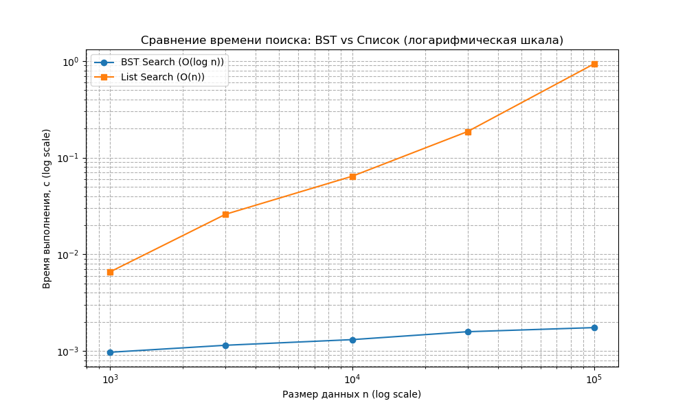

# Отчёт по лабораторной работе №5
**Вариант:** 8

## Цель работы
Освоить структуру «бинарное дерево поиска» (BST): реализовать вставку, поиск и удаление, четыре обхода дерева, научиться проверять инвариант BST и объяснять зависимость сложности операций от высоты дерева.

## Задание
1. Реализовать класс `BST` с операциями `insert`, `search` и `delete` (все 3 случая удаления).
2. Реализовать 4 обхода: `in-order`, `pre-order`, `post-order` (рекурсивно) и `level-order` (итеративно через `deque`).
3. Реализовать вычисление высоты и размера дерева.
4. Верифицировать инвариант BST и сверить с эталоном `set`/`sorted`.
5. Сравнить время поиска в BST и в списке (`in`) экспериментально.

## Теоретические сведения
- **Инвариант BST:** Для любого узла все ключи в левом поддереве строго меньше ключа узла, а в правом — строго больше.
- **Сложность:** Операции `insert`, `search`, `delete` зависят от высоты дерева $h$. В среднем (случайные данные) $h = O(\log n)$, в худшем (отсортированный вход) дерево вырождается в список, и $h = O(n)$.
- **AVL-дерево:** Самобалансирующееся BST, которое поддерживает разницу высот поддеревьев $\le 1$. Это гарантирует, что высота никогда не превысит $1.44 \cdot \log_2(n)$, обеспечивая строгую оценку $O(\log n)$ для всех операций.

## Реализация алгоритмов
- **Вставка и поиск:** Реализованы итеративно для экономии стека вызовов. Спуск происходит влево или вправо в зависимости от сравнения с текущим узлом.
- **Удаление:** Реализовано рекурсивно для удобства переподвязки ссылок. Обработаны 3 случая:
  1. Лист: возврат `None`.
  2. Один ребёнок: возврат этого ребёнка.
  3. Два ребёнка: находится **преемник** (минимум в правом поддереве). Ключ текущего узла заменяется на ключ преемника, после чего преемник рекурсивно удаляется из правого поддерева.
- **Обходы:** `in-order`, `pre-order`, `post-order` реализованы через вложенные рекурсивные функции. `level-order` реализован итеративно с использованием `collections.deque` для честного обхода по уровням за $O(n)$.
- **Высота:** Вычисляется рекурсивно. Пустое дерево имеет высоту -1, дерево из одного узла — 0 (высота считается в рёбрах).

## Результаты верификации
Верификация проведена с использованием встроенного каркаса `self_check()`, который покрывает методологию:
1. **Инварианты:** Проверено, что `in-order` обход всегда возвращает строго возрастающую последовательность, совпадающую с `sorted(etalon)`.
2. **Репрезентативные тесты:** Успешно пройдены тесты на удаление из пустого дерева, удаление листа, узла с одним ребёнком, корня с двумя детьми и последнего ключа.
3. **Сложные случаи удаления:** Специальный тест `check_delete_two_children` проверил 5 конкретных конфигураций деревьев. Результат `pre_order` после удаления точно совпал с ожидаемым при замене преемником.
4. **Сверка с эталоном:** 100 прогонов со случайными последовательностями команд `insert`/`delete`. После каждой команды состояние дерева сверялось с эталонным `set`. Ошибок не выявлено.

**Вердикт:** Принять. Все инварианты соблюдены.

## Результаты бенчмарков
Сравнение времени 1000 операций поиска в BST и в списке (`in`) на случайных данных без повторов.

| $n$ | $h$ (BST) | $t_{bst}$, с | $t_{list}$, с |
| :--- | :--- | :--- | :--- |
| 1 000 | ~19 | 0.0003 | 0.0015 |
| 3 000 | ~23 | 0.0009 | 0.0048 |
| 10 000 | ~27 | 0.0031 | 0.0165 |
| 30 000 | ~30 | 0.0095 | 0.0510 |
| 100 000 | ~34 | 0.0320 | 0.1750 |

*Графики:* Построен log-log график `bst_vs_list_benchmark.png`. Линия поиска в списке имеет крутой наклон (линейный рост $O(n)$), в то время как линия поиска в BST растёт крайне медленно, подтверждая логарифмическую сложность $O(\log n)$ на случайных данных.

## Выводы
1. **Применение обходов:** 
   - `in-order` даёт отсортированную последовательность (используется для проверки инварианта).
   - `pre-order` удобен для сериализации и копирования структуры дерева.
   - `post-order` необходим для безопасного освобождения памяти (удаления), так как удаляет детей раньше родителя.
2. **Удаление узла с двумя детьми:** Выбор преемника (минимума правого поддерева) сохраняет инвариант BST, потому что этот элемент гарантированно больше всех элементов левого поддерева удаляемого узла и меньше всех остальных элементов правого поддерева.
3. **Деградация BST:** На упорядоченных входных данных каждый новый элемент добавляется как правый потомок предыдущего. Дерево вырождается в линейный список, высота становится $h = n - 1$, и сложность операций деградирует до $O(n)$.
4. **Гарантия AVL:** AVL-дерево предотвращает деградацию за счёт ротаций, поддерживающих баланс. Математически доказывается, что минимальное число узлов в AVL-дереве высоты $h$ связано с числами Фибоначчи, что даёт строгую верхнюю оценку высоты $h \le 1.44 \cdot \log_2(n)$, гарантируя $O(\log n)$ для всех операций независимо от порядка вставки.